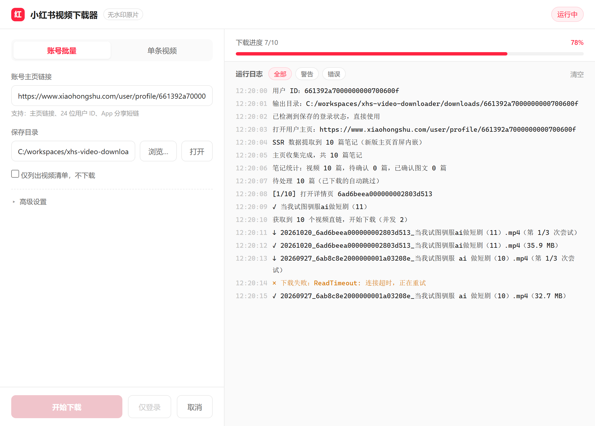

# 小红书账号视频批量下载工具

把一个小红书账号下的**全部视频**（无水印原片）批量下载到本地，支持断点续传。
提供**图形界面**与**命令行**两种方式。

> **合规边界（请先读）**
> 本工具仅限下载【你自己账号】或【已获得作者明确授权】的视频，用于个人备份、学习与研究。
> 请勿用于批量搬运、二次分发或任何商业用途。下载即代表你确认拥有相应权利。

## 📚 分步教程（源码级）

想把这套实现看懂、改得动？按 [tutorial/README.md](tutorial/README.md) 的路线读 8 篇：
从环境搭建 → 页面数据与风控原理 → 核心实现 → CLI/GUI 共用架构 → 桥接层 → 跨平台打包 → 测试排错 → 踩坑清单。

## 功能特性

- **图形界面**：双击即用的桌面窗口，填链接、点按钮、看实时日志和进度条
- **扫码登录**：首次运行弹出浏览器窗口，用小红书 App 扫码登录；登录态保存在本地，之后自动复用
- **全量收集**：SSR 数据提取（新版主页首屏）+ 接口拦截 + DOM 兜底三路合并，不漏笔记
- **单条下载**：粘贴单条笔记链接即可下载，无需是账号主页
- **无水印原片**：从笔记详情页提取视频直链，优先 h264 最高清晰度，非网页播放器压缩版
- **断点续传**：`state.json` 记录每篇笔记的下载/失败/跳过状态，中断后重跑自动跳过已完成的
- **防风控**：每篇笔记自带新鲜 `xsec_token` 访问详情页，避开 300031 风控；可调间隔
- **先预览再下载**：`--list-only` 只列出视频笔记清单，不下载

## 环境要求

- Python 3.10+（实测 3.11.9）
- Windows / macOS / Linux 桌面环境（登录环节需要能看到浏览器窗口）

## 安装

```bash
# 进入项目目录
cd xhs-video-downloader

# 建议用虚拟环境（可选）
python -m venv .venv
# Windows:
.venv\Scripts\activate
# macOS/Linux:
source .venv/bin/activate

# 安装依赖（含 GUI）
pip install -r requirements.txt

# 下载浏览器内核（约 200MB，只需一次）
python -m playwright install chromium
```

> 若只使用命令行，可只装核心依赖：`pip install playwright httpx`。
> GUI 还需要 `pywebview`；Windows 上依赖系统自带的 WebView2 运行时（Win10/11 一般已预装）。

## 图形界面（推荐新手）



```bash
python gui/app.py
```

或打包后直接双击 `xhs-video-downloader.exe`（见「打包为 exe」）。

**界面分两块：**

| 区域 | 说明 |
| --- | --- |
| 左侧表单 | 链接输入、保存目录、高级设置（并发/间隔/重试/Cookie） |
| 右侧面板 | 实时进度条 + 彩色分级日志（全部/警告/错误 可筛选） |

**两种模式：**

- **账号批量**：粘贴主页链接 / 用户 ID / App 分享短链 → 列出并下载该账号全部视频
  - 勾选「仅列出视频清单，不下载」可先预览
- **单条视频**：粘贴单条笔记链接（需含 `xsec_token`）→ 直接下载

**界面内扫码登录：** 点「仅登录」或直接「开始下载」，二维码会**弹窗显示在界面内**（无需切换到浏览器窗口），用小红书 App 扫一下即可，登录态自动保存。

**浏览器内核策略：** GUI 自动优先使用本机已安装的 **Chrome**（其次 Edge），无需下载 playwright 内核；都没装时才回退到 playwright 内核。

## 快速开始（命令行）

```bash
# 1. 先看看这个账号下有哪些视频（不下载）
python xhs_video_downloader.py --user https://www.xiaohongshu.com/user/profile/67a4612d000000000d009085 --list-only

# 2. 确认无误后全量下载（首次运行会弹出浏览器，扫码登录）
python xhs_video_downloader.py --user https://www.xiaohongshu.com/user/profile/67a4612d000000000d009085
```

下载结果保存在 `downloads/<用户ID>/` 下：

```
downloads/67a4612d000000000d009085/
├── 20241018_67a4612d000000000d0091_标题一.mp4
├── 20241020_67a4612d000000000d0092_标题二.mp4
├── ...
├── state.json          # 进度状态（断点续传靠它，勿删）
└── notes_index.json    # 视频元数据索引
```

> 登录态保存在项目目录的 `.xhs_profile/` 下。**删除该目录 = 退出登录**，下次运行需重新扫码。

## 登录方式（二选一）

**方式一：扫码登录（默认）**

在自己电脑上直接运行时（不要加 `--headless`），会弹出一个浏览器窗口，里面就是小红书的登录二维码，用 App 扫一下即可。登录态保存在 `.xhs_profile/`，之后自动复用。

**方式二：Cookie 注入（不方便扫码时）**

1. 在自己电脑的浏览器里登录小红书网页版
2. 按 F12 → 网络（Network）→ 刷新页面 → 点任意一个请求 → 请求头里找到 `Cookie`，整串复制（至少要含 `web_session=...`）
3. 保存到文本文件（如 `cookie.txt`），然后：
   ```bash
   python xhs_video_downloader.py --user <主页链接> --cookie-file cookie.txt
   ```
   或直接内联：`--cookie "web_session=xxx; a1=yyy"`

> Cookie 等同于登录凭证，勿泄露给他人；失效后重新复制一份即可。

## 如何拿到账号主页链接

1. 手机 App 打开该用户主页 → 右上角分享 → 复制链接，粘贴即可（工具会自动跟随短链跳转、提取用户 ID 和 xsec_token）
2. 或电脑浏览器打开 `https://www.xiaohongshu.com/user/profile/xxxxxxxx`，直接复制地址栏链接
3. 或只填 24 位用户 ID（主页链接里 `/user/profile/` 后面那串）

## 参数说明

| 参数 | 默认值 | 说明 |
| --- | --- | --- |
| `--user` | （必填） | 主页链接 / 24 位用户 ID / App 分享短链 |
| `--out` | `./downloads` | 下载目录 |
| `--profile-dir` | `./.xhs_profile` | 浏览器用户数据目录（保存登录态） |
| `--list-only` | 关 | 只列出视频笔记，不下载 |
| `--max` | 0 | 最多处理多少篇笔记（0 = 全部，调试用） |
| `--delay` | 1.5 | 每篇详情页之间的间隔秒数，越大越安全但越慢 |
| `--concurrency` | 2 | 下载并发数 |
| `--retries` | 3 | 单文件下载重试次数（自动切换备用 CDN 地址） |
| `--scroll-pause` | 1.2 | 主页滚动停顿秒数 |
| `--login-timeout` | 300 | 扫码登录等待秒数 |
| `--qr-screenshot` | 无 | 登录二维码截图保存路径（无头/远程运行时推荐，保存后可发给用户扫描） |
| `--device-scale-factor` | 1.0 | 浏览器渲染缩放，二维码截图不清晰时设为 2 |
| `--cookie` | 无 | 直接注入浏览器 Cookie（如 `web_session=xxx; a1=yyy`），跳过扫码 |
| `--cookie-file` | 无 | 从文件读取 Cookie 字符串（内容同上，适合超长 Cookie） |
| `--dump-api` | 关 | 巡检并打印页面发起的所有 API 请求路径（小红书改版时用于诊断） |
| `--headless` | 关 | 无头模式（**注意：容易被风控重定向到登录页，见常见问题**） |
| `--channel` | 无 | 传 `chrome` 则使用本机安装的 Chrome |
| `-v` | 关 | 调试日志 |

## 工作原理

```
扫码登录（Playwright 持久化上下文，Cookie 落盘）
        │
        ▼
打开用户主页 ──► 三路合并收集笔记：
        │          ① SSR 数据提取（新版主页首屏笔记内嵌于
        │             window.__INITIAL_STATE__.user.notes，自带 xsec_token）
        │          ② 接口拦截（翻页接口，兼容改名）
        │          ③ DOM 兜底（解析主页里的笔记链接）
        ▼
逐篇打开详情页（URL 带上 SSR 里的新鲜 xsec_token，避开 300031 风控）
        │          提取双路径：
        │          ① window.__INITIAL_STATE__.note.noteDetailMap
        │             （页面内逐字段提取，流数据异步就绪需轮询）
        │          ② ApiSniffer 捕获接口响应递归查找
        │          识别 300031 重定向自动重试
        ▼
httpx 并发下载（带 Referer/Cookie，master_url 失败自动切 backup_urls）
        │
        ▼
写入 downloads/<用户ID>/，进度实时写入 state.json
```

关键设计点：

- **不走第三方解析服务**：直链来自小红书自己的页面数据，没有中间人，也不怕解析网站跑路
- **拿的是原片**：与播放器里画质一致，不受网页版压缩影响（个别作者关闭下载权限的除外）
- **自带 token 防风控**：每篇笔记的详情页 URL 都带上主页 SSR 数据里的新鲜 `xsec_token`，这是绕开 300031"当前笔记暂时无法浏览"的关键
- **兼容两套字段命名**：接口返回 snake_case（`master_url`）、SSR 返回 camelCase（`masterUrl`），提取层做了归一化
- **断点续传**：`Ctrl+C` 中断或中途失败，重跑同一条命令即可继续；解析失败的笔记记入 `failed`，重跑自动重试

## 常见问题

**Q：首次运行没弹出二维码？**
A：确认没有加 `--headless`；二维码在自动弹出的浏览器窗口里，窗口可能被其他窗口盖住。

**Q：提示"登录状态已失效"？**
A：Cookie 过期了。删除 `.xhs_profile` 目录后重新运行，再次扫码。

**Q：`--headless` 无头模式一打开就被跳到登录页？**
A：这是风控行为（实测无头访问会被重定向）。解决办法：① 先用非无头模式跑一次，扫码登录，之后无头可复用登录态；② 直接用 `--cookie` 注入登录 Cookie；③ 无头 + `--qr-screenshot` 保存二维码截图扫码。

**Q：收集笔记数为 0？**
A：依次检查：① 账号是否已私密 ② 是否弹出滑块验证码（需在浏览器里手动完成）③ 登录是否失效。小红书改版时数据结构可能变化，可加 `-v` 看详细日志。

**Q：提示"当前笔记暂时无法浏览"（error_code=300031）？**
A：详情页缺有效 `xsec_token` 或触发风控。工具已内置对策：详情页 URL 自动携带主页 SSR 数据里的新鲜 token，被拦截时自动重试一次。若仍全部失败：① 重新从 App 分享主页链接获取新 token 重跑；② 调大 `--delay`（如 3 秒）；③ 换网络环境。重跑时失败的笔记会自动重试（`state.json` 里记在 `failed`，不是 `skipped`）。

**Q：提示"IP存在风险，请切换可靠网络环境后重试"（error_code=300012）？**
A：小红书风控把当前出口 IP 列入了风险名单（常见于云服务器/机房 IP，或短时间内多次自动化访问）。解决办法：① 换到家庭/办公宽带等正常网络环境再跑；② 用 `--cookie` / `--cookie-file` 注入自己浏览器里的 Cookie；③ 等待数小时至数天风控解除。在服务器/远程环境运行时建议直接用 Cookie 注入。

**Q：全部笔记都提示"详情解析失败"？**
A：详情页取不到数据了（小红书前端改版，SSR 数据结构和接口都可能变）。工具已内置三路提取（SSR 字段提取 + 接口嗅探 + 300031 重试）；若仍全部失败，加 `--dump-api -v` 重跑，把日志里 `[API 巡检]` 打印的接口路径发给我，我按新接口适配。解析失败的笔记下次重跑会自动重试（确认是图文的才会跳过）。

**Q：能下载图文笔记的图片吗？**
A：当前版本只下视频。图文笔记会被标记为 skipped。

**Q：网页版主页只能看到部分笔记？**
A：极少见，通常是风控限流。调大 `--scroll-pause`（如 2.5）和 `--delay`（如 3）降低频率后重跑；`state.json` 会保证已下载的部分不重复。

**Q：下载自己的全部视频做备份，有更快的办法吗？**
A：如果量不大（几十条），App 内逐条"保存到相册"也行；超过 100 条用本工具会明显省时间。

**Q：界面启动后一片空白 / 报 WebView2 相关错误？**
A：说明缺少 WebView2 运行时。Win10/11 通常已随 Edge 预装；若确实缺失，去微软官网搜「WebView2 Runtime」下载 Evergreen 安装包装上即可。

**Q：界面点开始后没反应？**
A：看右侧日志。最常见是登录失效，此时会弹出二维码窗口，扫码即可。

## 打包为独立程序（Windows / macOS / Linux）

> **重要**：PyInstaller **不支持交叉编译**——要出 Windows 版就在 Windows 上构建，
> 要出 mac 版就在 macOS 上构建，各平台各自打各自的包。

### 推荐：用构建脚本（自带环境自检）

```bash
chmod +x build.sh
./build.sh --check     # 只做环境自检（含架构检测，先跑这个）
./build.sh             # 自检 + 构建
./build.sh --clean     # 清理旧产物后重新构建
```

脚本会**自动检测架构并给产物命名**，避免多机器构建时分不清：

| 平台 | 架构 | 产物名 |
| --- | --- | --- |
| macOS | Apple Silicon | `dist/xhs-video-downloader-arm64.app` |
| macOS | Intel | `dist/xhs-video-downloader-x64.app` |
| macOS | 双架构 | `dist/xhs-video-downloader-universal2.app` |
| Windows | x64 | `dist/xhs-video-downloader-x64/xhs-video-downloader-windows-x64.exe` |
| Linux | x64 | `dist/xhs-video-downloader-x64/xhs-video-downloader-linux-x64` |

> **架构提示**：决定产物架构的是**你用的 Python 解释器**，不一定是机器硬件。
> 例如 M 系列 Mac 上装了 Intel 版 Python，构建出的就是 Intel 包（反而能通吃两种机型）。
> 脚本自检时会打印架构与兼容性说明。

### 手动构建

```bash
pip install pyinstaller
python -m PyInstaller build_exe.spec --noconfirm
```

| 平台 | 默认产物 |
| --- | --- |
| Windows | `dist/xhs-video-downloader/xhs-video-downloader.exe`（连同整个目录拷贝） |
| macOS | `dist/xhs-video-downloader.app`（目录形式，需 `chmod +x` 或 `xattr -cr` 解决 Gatekeeper 拦截） |
| Linux | `dist/xhs-video-downloader/xhs-video-downloader` |

> ⚠️ **务必运行 `dist/` 里的程序，不要运行 `build/` 里的同名文件！**
>
> PyInstaller 在 `build/` 目录也会生成一个同名 exe（中间产物），它**缺少同级的
> `_internal` 依赖目录**，直接运行会报：
> ```
> Failed to load Python DLL '...\build\build_exe\_internal\python311.dll'
> LoadError: 找不到指定的模块。
> ```
> `build/` 是编译缓存目录，可以随时删除；`dist/` 才是可运行的成品。


> **实测体积：128MB**（Windows 验证），远小于连内核一起打包的 1GB+。

**关于体积与浏览器内核**：打包**不包含**浏览器内核（约 437MB，打进去会让体积失控）。
程序运行时会自动探测本机浏览器：
- Windows：Chrome / Edge
- macOS：`/Applications/Google Chrome.app`、`Microsoft Edge.app`
- Linux：`google-chrome`、`chromium`、`microsoft-edge`

若都没有，回退使用 playwright 内核（需用户自行 `python -m playwright install chromium`）。

**macOS 用户请看**：[docs/BUILD-macOS.md](docs/BUILD-macOS.md) —— 含完整构建步骤、
9 项自检清单、常见问题（Gatekeeper 拦截 / PyObjC 缺失 / 架构不匹配）与结果记录表。

### 应用图标

图标为**原创设计**（正红 `#ff2442` + 白色下载箭头），特意**不使用小红书官方 logo**
以避免商标风险，视觉效果贴近小红书风格。

```bash
pip install pillow
python assets/make_icon.py     # 重新生成 icon.ico / icon.png / icon.iconset
```

macOS 需额外转 `.icns`（构建 `.app` 时用）：

```bash
iconutil -c icns assets/icon.iconset -o assets/icon.icns
```

打包时会自动选择：Windows 用 `icon.ico`，macOS 用 `icon.icns`。

## 运行测试（可选）

```bash
python tests/test_unit.py          # 纯函数测试，无需浏览器
python tests/test_integration.py   # 集成测试（mock 页面与接口，需已装 chromium）
python gui/selftest.py             # GUI 端到端自测（单条模式）
python gui/selftest.py account     # GUI 端到端自测（账号 list-only 模式）
python gui/test_finish_once.py     # 回归：任务结束提示只触发一次
python gui/test_toast_flash.py     # 回归：完成提示不闪烁（真实 JS 环境）
```

## 项目结构

```
xhs-video-downloader/
├── xhs_video_downloader.py   # 核心（含 JobConfig / run_job 适配层，CLI 与 GUI 共用）
├── gui/
│   ├── app.py                # GUI 启动入口（pywebview）
│   ├── bridge.py             # JS ↔ Python 桥接（轮询式，规避跨线程限制）
│   ├── platform_utils.py     # 跨平台探测（浏览器 / 打开目录 / 内核目录）
│   ├── index.html            # 界面（小红书风格，原生 HTML/CSS，无构建步骤）
│   ├── selftest.py           # GUI 端到端自测
│   ├── test_finish_once.py   # 回归测试：完成提示只触发一次
│   ├── test_toast_flash.py   # 回归测试：提示不闪烁
│   └── render_preview.py     # 生成界面预览图（用于文档）
├── assets/
│   ├── make_icon.py          # 图标生成脚本（原创设计，非官方 logo）
│   ├── icon.ico              # Windows 图标（多尺寸）
│   ├── icon.png              # 1024×1024 预览
│   └── icon.iconset/         # macOS iconset（用 iconutil 转 .icns）
├── docs/
│   ├── gui-preview.png       # 界面预览图
│   └── BUILD-macOS.md        # macOS 构建与自检清单
├── build.sh                  # 跨平台构建脚本（自带环境自检）
├── build_exe.spec            # PyInstaller 配置（含 macOS BUNDLE）
├── run_live.py               # 命令行实跑入口（日志写 live_run.log）
├── download_single.py        # 单条下载命令行脚本
├── requirements.txt
├── README.md
├── tests/
│   ├── test_unit.py          # 纯函数单元测试
│   └── test_integration.py   # Playwright + 本地 HTTP mock 集成测试
├── tutorial/                 # 源码级分步教程（8 篇，按学习路线阅读）
│   └── README.md             # 教程总览与索引
└── .gitignore
```

## 跨平台支持

核心逻辑与界面均无平台绑定，Windows / macOS / Linux 通用。差异集中在
`gui/platform_utils.py` 一处：

| 差异项 | Windows | macOS | Linux |
| --- | --- | --- | --- |
| 浏览器探测 | `C:\Program Files\...` | `/Applications/...` | `which google-chrome` 等 |
| 打开目录 | `os.startfile` | `open` | `xdg-open` |
| 内核缓存目录 | `%LOCALAPPDATA%\ms-playwright` | `~/Library/Caches/ms-playwright` | `~/.cache/ms-playwright` |
| 窗口后端 | WebView2（pythonnet） | WKWebView（cocoa） | GTK / Qt |

## 架构说明

GUI 与 CLI **共用同一套核心**，仅入口不同：

```
CLI  ──┐
       ├──► JobConfig ──► run_job(cfg, on_progress, cancel_event) ──► 四个核心组件
GUI  ──┘                    （BrowserSession / NoteLister /
                             fetch_note_detail / VideoDownloader）
```

**跨线程通信采用前端轮询**（而非 `evaluate_js` 回推）：pywebview 的 `evaluate_js`
必须从 UI 主线程调用，在后台工作线程里调用会挂起。因此后台任务只写线程安全的
缓冲区，前端每 400ms 通过 `get_updates(since)` 增量拉取日志与进度——既不阻塞任务，
也天然保证日志有序。
