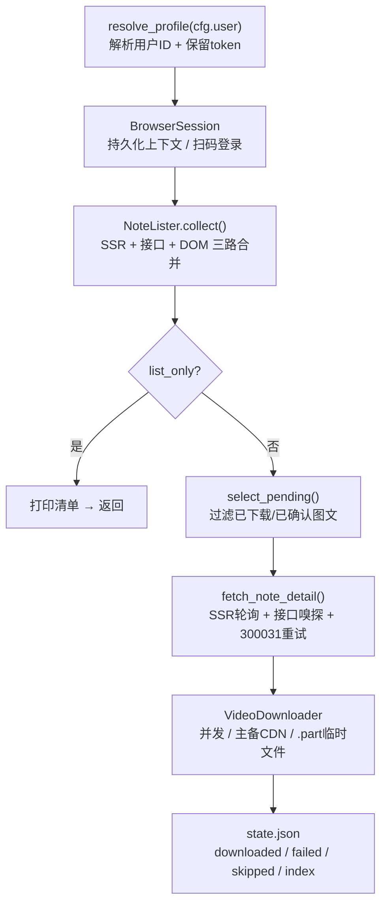

# 03 · 核心实现：从登录到落盘

> 目标：把上一篇的原理串成一条可执行的主流程，逐个读懂 5 个组件。
> 读完你应该能在 `run_job()` 里找到任意一步对应的代码。

---

## 1. 主流程全图



入口是 `run_job()`（`xhs_video_downloader.py:1250`）。它的签名就是整套架构的缩影：

```python
async def run_job(
    cfg: JobConfig,
    on_log=None,          # 日志回调（可选）
    on_progress=None,     # 进度回调（可选）
    cancel_event=None,    # 取消信号（可选）
    qr_callback=None,     # 二维码回调（可选）
    login_only: bool = False,
) -> JobResult:
```

所有回调都是可选的——CLI 一个都不传，行为完全不变。这是第 4 篇要重点讲的兼容设计。

---

## 2. 组件一：`BrowserSession` —— 登录态与浏览器

源码位置 `:344-532`。核心是 Playwright 的**持久化上下文**：

```python
self.context = await self._pw.chromium.launch_persistent_context(
    user_data_dir=str(self.profile_dir),   # Cookie 落盘到这里
    headless=self.headless,
    viewport=VIEWPORT,
    user_agent=USER_AGENT,
    channel=self.channel,                  # 'chrome' / 'msedge' / None
    device_scale_factor=self.device_scale_factor,
    args=["--disable-blink-features=AutomationControlled"],
)
```

`user_data_dir` 是关键：浏览器关闭后 Cookie 留在这个目录，下次启动自动带上。
删除 `.xhs_profile/` 就等于退出登录。

### 登录判据的演进

`_logged_in()`（`:393`）的注释记录了一个真实踩坑：

> 实测 2026-10：`user.loggedIn` 已变为响应式对象而非 boolean。

所以判据改成优先级链：

1. URL 含 `/login` → 未登录
2. `userInfo.userId / user_id / id` 存在 → 已登录（**主要判据**）
3. `loggedIn === true` 或 `'true'` → 已登录
4. 页面上 `.login-container` 或二维码组件可见 → 未登录

注意注释里的提醒：`web_session` Cookie 对匿名访客也会下发，**不能拿它当登录判据**。

### 二维码的两条路

```python
async def save_qr_screenshot(self, path):
    # 逐个 selector 尝试，找不到就截整页
    ...
    return base64.b64encode(png_bytes).decode("ascii")
```

- CLI：`path` 非空 → 落盘成图片文件
- GUI：`path=None` → 只返回 base64，通过 `qr_callback` 推给前端弹层显示

`cookies_httpx()`（`:502`）把 `xiaohongshu.com` 和 `xhscdn.com` 域下的 Cookie 导出成 dict，
供 httpx 下载视频时带上——这是“浏览器登录，httpx 下载”的衔接点。

---

## 3. 组件二：`NoteLister` —— 三路合并收集

源码位置 `:538-788`。内部状态是一个以 note_id 为键的字典：

```python
self.notes: dict[str, dict] = {}
```

这样三路数据天然按 ID 去重，后到的可以补前面缺的字段：

```python
existing = self.notes.get(note_id) or {}
token = token or existing.get("xsec_token")
...
"type": card.get("type") or existing.get("type") or "unknown",
```

### 滚动策略

`collect()`（`:742`）不是无脑滚到底：

```python
idle = 0
await self._ssr_scrape()          # 首屏
while self._has_more:
    before = len(self.notes)
    await self.page.evaluate("window.scrollTo(0, document.body.scrollHeight)")
    await self.page.wait_for_timeout(int(scroll_pause * 1000))
    await self.page.evaluate("window.scrollBy(0, -300)")   # 往回退一点
    await self.page.wait_for_timeout(500)
    await self.page.evaluate("window.scrollTo(0, document.body.scrollHeight)")
    await self.page.wait_for_timeout(int(scroll_pause * 1000))
    await self._ssr_scrape()      # 每轮都重取 SSR
    if len(self.notes) > before:
        idle = 0
    else:
        idle += 1
        if idle >= max_idle_rounds:   # 连续 4 轮没新增就停
            break
```

`scrollBy(0, -300)` 这一下看着多余，实际是为了**触发懒加载边界**——有些页面一直贴底反而不加载。
`max_idle_rounds=4` 是防死循环：账号笔记数有限，滚到没新数据就该收手。

---

## 4. 组件三：`fetch_note_detail` —— 直链提取

源码位置 `:820-1000`。上一篇已经讲过它的三条路径，这里看它如何组织：

1. `sniffer.clear()` —— 每篇笔记前清空捕获，避免串台
2. 打开详情页，检测 300031 → 必要时重试一次
3. SSR JS 轮询最多 10 次，每次 600ms
4. 根据 `type` 分流：
   - `video` + 有流 → 返回结果
   - 明确图文 → 立即返回（标记 skipped）
   - `video` 但流未就绪 → 继续轮询
5. 仍失败 → `ApiSniffer.find_video_for_note()` 兜底
6. 都没有 → 返回 `None`（记入 `failed`，下次重试）

返回值统一成：

```python
{
    "type": "video",
    "title": ...,
    "time": ...,
    "video": { "master_url": ..., "backup_urls": [...], "width": ..., "height": ... },
    "video_meta": { "duration_ms": ..., "size": ... },
}
```

`pick_best_stream()`（`:103`）的挑选规则：**先按编码优先级 h264 > h265 > av1 > h266，
同编码再按分辨率降序**。选 h264 是因为兼容性最好。如果遇到混淆键名（实测见过 `EF4`），
就退化成“遍历所有键、按清晰度挑”。

---

## 5. 组件四：`VideoDownloader` —— 并发下载

源码位置 `:1006-1145`。几个设计点：

### 信号量限制并发

```python
self.sem = asyncio.Semaphore(max(1, concurrency))
...
async with self.sem:
    ...
```

不是同时开 N 个协程狂冲，而是用信号量卡住同时进行的请求数。

### `.part` 临时文件 + 原子替换

```python
tmp = target.with_suffix(".part")
async with self.client.stream("GET", url) as resp:
    with open(tmp, "wb") as fh:
        async for chunk in resp.aiter_bytes(1024 * 256):
            if self._cancelled():
                raise asyncio.CancelledError("用户取消")
            fh.write(chunk)
            total += len(chunk)
tmp.replace(target)
```

好处：中途失败/取消不会留下半截的 `.mp4` 被误认为成功。

### 主备 CDN 轮换

```python
urls = [stream.get("master_url"), *(stream.get("backup_urls") or [])]
...
url = urls[(attempt - 1) % len(urls)]
```

第 1 次用主地址，第 2 次用备地址 1，第 3 次用备地址 2……循环重试。
带 `Referer` 和浏览器 Cookie，因为 CDN 直链通常有防盗链校验。

### 取消检查点

`_cancelled()` 在两处被调用：下载前、每个 chunk 写入前。
也就是说取消请求最多延迟一个 256KB chunk 生效，不会“点了取消还在狂下”。

---

## 6. 组件五：`DownloadState` —— 断点续传

源码位置 `:298-338`。保存时用临时文件 + `replace`：

```python
tmp = self.path.with_suffix(".tmp")
tmp.write_text(json.dumps({...}, ensure_ascii=False, indent=2), encoding="utf-8")
tmp.replace(self.path)
```

这是**原子写**：即使写入过程中断电，`state.json` 也不会变成半截 JSON。
`load()` 遇到损坏文件不会崩，而是打 warning 后按空状态继续。

每成功下载一个文件就 `state.save()` 一次——宁可多写几次，也不要跑一小时最后全丢。

---

## 7. 主流程里的三个分支

回到 `run_job()`，注意三个提前返回：

| 分支 | 条件 | 行为 |
| --- | --- | --- |
| 单篇模式 | `cfg.single_note` | 走 `_run_single()`，跳过主页收集 |
| 仅登录模式 | `login_only and not cfg.user` | 登录完就返回，output 到 `login_only_done` |
| 清单模式 | `cfg.list_only` | 收集完打印清单，发 `list_done` 进度，返回 |

单篇模式（`_run_single()`，`:1467`）的流程是“解析笔记 ID → 登录 → 详情页提取 → 下载到
`downloads/single/`”。注意它虽然也用 `VideoDownloader`，但 `on_progress=None`——
单篇只有 1 个文件，不需要细粒度进度。

---

## 动手实验

1. 在 `run_job()` 的 `stage="collected"` 那行加一个 `emit_log`，打印 `notes` 里各 `type` 的数量。
2. 把 `pick_best_stream()` 的编码优先级改成 `h265` 优先，跑 `tests/test_unit.py`，
   看 `test_pick_best_stream` 立刻变红——这就是单测的价值。
3. 把 `VideoDownloader` 的 `retries` 传成 1，模拟一次失败，观察 `state.json` 的 `failed` 桶。
4. 追踪一个 `stage` 事件从 `run_job()` → `_progress()` → `get_updates()` → 前端进度条的完整路径。

---

## 小结

- `BrowserSession` 管登录态和 Cookie 导出
- `NoteLister` 三路合并、按 ID 去重、滚动到连续 4 轮无新增
- `fetch_note_detail` SSR 轮询 + 接口兜底 + 300031 重试
- `VideoDownloader` 信号量并发、`.part` 原子替换、主备 CDN 轮换、可取消
- `DownloadState` 原子写盘，三桶语义决定重跑行为

现在你已经能读懂核心代码了。下一个问题是：**同一套核心怎么同时服务命令行和图形界面？**
这就是架构适配层。
